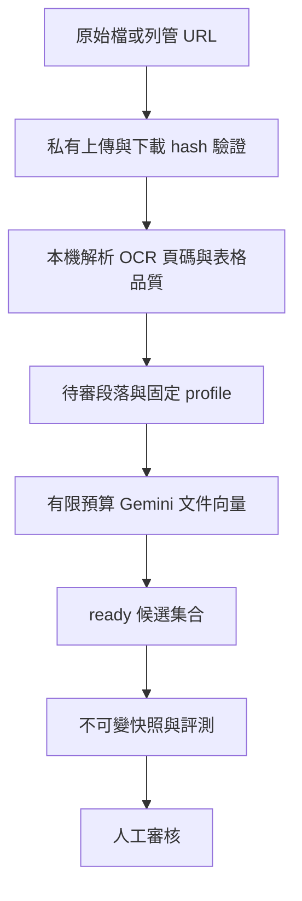
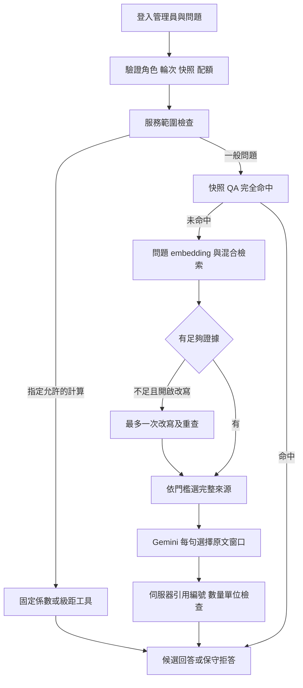

# CarbonGuide RAG 管理介面使用說明

更新：2026-10-27。本文件說明 RAG v1 的實作、操作與人工審閱方式。部署網址、語料覆蓋及評測結果另見[本輪驗收紀錄](rag-v1-delivery.zh-TW.md)；本機程式已完成不代表雲端已更新。

本階段提供管理員候選知識庫與有限額試問。**真實內容仍待人工審核，一般回答服務關閉，Flutter App 尚未接入。**

## 先理解四個狀態

| 狀態 | 意義 |
|---|---|
| 原始檔已驗證 | 檔案存入私有 Storage，下載 SHA-256 與上傳內容相同 |
| 處理 ready | 解析及指定 profile 的向量已備妥；不是內容核准 |
| 不可變候選快照 | 固定來源、段落、QA、人格、提示詞、設定、計算資料與模型契約，可做版本限定試問 |
| 人工核准及發布 | owner 明確審核該 snapshot hash；還需通過同一版本的驗收門檻，才可設定為啟用版本 |

發布知識版本與開放一般使用者是兩個不同開關。本階段不能藉發布解除公開服務限制。候選資料中的歷史年份、地區、表格條件都必須核對。

## 登入與操作順序

1. 開啟受保護的 Vercel Preview `/push-admin#rag`。先完成 Vercel 登入，再以既有管理員 Google 帳號登入 CarbonGuide。
2. 到「文件與段落」確認原始檔、解析品質、頁碼及候選內容；來源下載連結短效且需要權限。
3. 到「通用 QA」、「人格與提示詞」及「RAG 設定」整理草稿。QA 與計算草稿要附可核對的來源。
4. 在「知識版本」選擇已 ready 的段落集合及草稿，建立命名快照。之後改草稿不會改動這個版本。
5. owner 建立有期限、預算、題數及每日上限的試用輪次，指定候選版本。到「試問」選輪次及人格，送出一次問題。
6. 檢查回答引用與流程；需要比較版本時建立新快照與新輪次，保留舊紀錄。
7. 在「試問」上傳固定的 development／acceptance JSON 題庫並執行評測。先處理開發題問題，再跑保留的驗收題；在「知識版本」核對同一快照的報告及發布條件。
8. 最後人工逐項核對來源、QA、計算、回答與評測結果，再對指定 hash 做審核。程式不會代替你核准真實內容。

單純瀏覽、重新整理、讀歷史紀錄不會呼叫模型。送出後若逾時，先讀本次 request 狀態；關閉頁面不代表後端已取消。未知結果不自動重試或退還配額。

## 七個畫面

| 畫面 | 功能與限制 |
|---|---|
| 文件與段落 | 私有原始檔上傳、URL 登記與狀態、解析品質、分頁段落瀏覽、分類及候選修訂。解析與文件 embedding 由維護者執行本機 CLI |
| 通用 QA | 問答草稿及逐字來源引用；只有被快照選入的 QA 才參與該版本回答 |
| 人格與提示詞 | 維護語氣及回答草稿；不能覆寫後端的權限、來源及費用限制 |
| 試問 | 有期限的有限輪次、單題問答、指定確定性計算、引用、處理流程、歷史結果、題庫與評測執行 |
| 知識版本 | 不可變快照、評測報告、人工核准／駁回、發布及回滾；空報告不是通過 |
| 互動紀錄 | owner 查看 v1 的問題、回答、引用、流程與成本；可篩選人工試問／自動評測。舊版追蹤另行收合 |
| RAG 設定 | 檢索草稿、係數與電價計算草稿、準備／試問／評測成本、帳單 CSV 對帳、預算與營運狀態 |

目前仍只開放既有管理員白名單。owner 管理預算、輪次、評測、審核與發布；editor 可在授權範圍整理草稿與試問；viewer 的讀取範圍由 RLS/RPC 限制。新增人員需要另一個明確的權限變更。

## 檢視詳情與找回問答

- **文件**：列表每頁 12 份，可先搜尋名稱、用途或領域。按「檢視」會在目前視窗開啟詳情，選擇文件版本、段落集合後，每頁查看 25 段；換頁會回到新頁開頭。匯入與逐檔處理進度在列表上方的「匯入文件與查看處理進度」內。
- **草稿與流程**：QA、人格、提示詞、計算資料的編輯，以及新版試問和舊版追蹤詳情，都在獨立視窗內操作。右上角「關閉詳情」或 Esc 可關閉並回到原本列表位置；尚未儲存的編輯會捨棄，儲存中暫時不能關閉。手機版採滿版詳情。
- **互動紀錄**：預設顯示「人工試問」，卡片直接列出問題與回答摘要，每頁 20 筆。按「查看完整問答與流程」可讀完整問題、回答、引用來源／頁碼及各流程節點。要看自動測試題，將「紀錄來源」改為「自動評測」或「全部新版紀錄」。只有 owner 可以讀取這組完整紀錄。
- **保存限制**：新版正文與詳細流程保留 30 天；過期後只顯示保留的狀態與費用。舊版「只有代碼與流程」的紀錄當時沒有保存問答正文，無法事後還原。拒答或未完成的紀錄會說明處理狀態，不會補造答案。
- **知識版本**：長來源清單預設收合；展開「包含的來源與品質警示」即可逐份核對。

以上檢視、分頁與重新讀取都只讀既有資料，不會重新呼叫 Gemini 或占用試問題數。

## 文件與網址匯入

若解析含無法解碼字元，預設拒絕匯入。維護者可明確使用隔離模式，整段排除有問題的內容，保留原始檔及解析結果，另建候選版本。在「文件與段落」及「知識版本」展開品質提示，可看到受影響物理頁與原始段落序號。這表示內容不完整，不能把缺少的數字或正負號自行補回；核對來源後再建立修正版。

本機原始清單為 45 份：40 PDF 共 1,120 頁、4 DOCX、1 JSON；45 份已上傳私有 bucket 並下載核對 SHA-256。DOCX 中網址另建立抓取工作，不把「文件內有連結」視為已讀取網站內容。

加上成功取得的網址快照，本輪共保存 53 份私有來源；最終問答候選選入 47 份 PDF、1,834 頁及 9,271 段。193 個原始段落被整段隔離，導覽 DOCX／HTML 與未審 JSON 未選入。完整數據、評測失敗與五題人工試問輪次見[本輪驗收紀錄](rag-v1-delivery.zh-TW.md)。

`rag-originals` 上限是 **20 MiB（20,971,520 bytes）**，這批最大約 15.75 MiB。維持現有限制即可，不需要提高 bucket 額度。前端與後端都檢查大小、格式及 hash；重複匯入使用已驗證來源，不覆寫原檔。

URL worker 只接受列管的 HTTPS 網域：IPCC、能源署、自來水公司、國發會。每次 DNS 解析及轉址都檢查公開 IP、固定連線 IP 並驗證 TLS；最多三次轉址、90 秒及 20 MiB。網頁 JavaScript、外部圖片與登入內容不執行或下載。HTML 以私有純文字快照保存，再以靜態結構解析。憑證驗證失敗會留下失敗原因，不會關閉 TLS 驗證。

解析由本機 Python／Docling 執行，CPU、記憶體及時間有上限。長 PDF 分頁處理後必須核對每一物理頁完整且不重複，才能合併為全文候選。表格保留欄位、標題、頁碼與完整引用內容；供搜尋的短片段與供回答的完整表格分開。稀疏圖片頁使用本機 RapidOCR，沒有額外雲端 OCR 費用。

缺字、亂碼、OCR、分頁表格、研究適用範圍與檔名／文章標題不一致都需要人工處理。系統不猜測缺失的負號、上標或係數。JSON 的 1,164 筆係數只是原始候選，不能直接當成現行有效排放係數。

## 模型與方法

| 工作 | 實作 |
|---|---|
| 文件／查詢 embedding | `gemini-embedding-001`，768 維，文件 RETRIEVAL_DOCUMENT、問題 RETRIEVAL_QUERY，L2 正規化 |
| 向量檢索 | PostgreSQL pgvector cosine 精確搜尋，只讀本次快照指定集合 |
| 關鍵字檢索 | PGroonga 中文詞項搜尋 |
| 排名合併 | Reciprocal Rank Fusion，k=50；不是正確率或信心百分比 |
| 生成 | `gemini-3.1-flash-lite`，temperature 0、單一候選、最多 2,048 output tokens、受限 JSON schema |
| 驗證 | 後端確定性規則：來源 ID、原文窗口、引用編號、數字、量級、單位與輸出大小 |
| 計算 | BigInt 八位小數運算，不由語言模型心算 |

Embedding 是搜尋索引，不是模型微調。不同模型／維度／分段契約使用不同 profile，不混用向量。同一份已驗證輸入可以重用向量，不會每次提問都重新向量化整批文件。原計畫中的 OpenAI 模型比較仍暫緩，本輪採 Gemini。

Google 的 [embedding 用法](https://ai.google.dev/gemini-api/docs/embeddings)、[結構化輸出](https://ai.google.dev/gemini-api/docs/structured-output)與[價格表](https://ai.google.dev/gemini-api/docs/pricing)是模型介面參考。這份文件描述固定實作，不宣稱模型是最新或適合所有語料。

## 每題回答流程

1. 權限檢查不依賴前端按鈕。後端驗證 JWT、目前管理員角色、輪次名單、到期、版本與來源停用狀態。
2. 請求先占用題數；每一次模型呼叫另外原子預留費用並寫入開始紀錄，才連線 Google。相同 request ID 及內容不能重複執行。
3. QA 只做保守的完全命中，使用快照內已有來源的答案。這裡不是模糊 QA 相似度命中；設定中的 QA threshold 不能當成此分支的精準度保證。
4. 未命中則做問題向量與混合檢索。依快照門檻篩選、相同表格脈絡去重，上限 12 個完整來源、80 KB；預設設定是 20 個候選、6 個來源、相似度 0.72。
5. 可選改寫最多一次，僅證據不足時執行；改寫前後數值、貨幣、量級與單位必須一致。本次候選預設關閉改寫，不會自行啟用付費分支。
6. 生成模型為每句話選擇伺服器提供的連續原文窗口 ID，伺服器再產生引用編號與逐字摘錄。每句的數量只可由該句所選來源支持。這避免模型自行拼接引文或編錯索引。
7. 找不到證據、引用或數值檢查不通過時拒答。沒有第二個模型自動修復，也沒有隱藏的付費重試。

上述是新快照的回答契約；舊 v1／v2／v3 快照保留當時契約，以便重現差異。通過字串驗證仍不代表語意、因果或適用條件正確，這部分由人工審閱。

單題沒有跨題聊天記憶、不進行任意網路搜尋、不執行模型產生的 SQL 或 shell。工具最多三次，只能呼叫程式列管計算；不允許任意代理工具。

## 電費與係數計算

電費工具計算指定地區、有效期間及一個或兩個完整月份的住宅流動電費差額。先分別按所有級距計算前後費用，再相減；兩個月級距倍增，金額取至分。它不是將節省度數乘單一邊際費率。

本輪電價草稿是有來源的歷史非夏月測試資料，限定 2025 年 10–12 月，期間是測試選擇，不宣稱來源於年底失效。**不包含基本費、稅、附加費、跨季或不完整月份，也不是完整帳單。** 水費、時間電價及車型油耗計算仍屬 v1.1。

係數工具要求輸入與輸出單位、地區、有效日期、原始證據及版本。JSON 中年份或單位不完整的原始資料必須先人工釐清；不能自動當成可發布係數。

## 流程、成本與停止方式

點選每題的流程節點可看到執行／跳過／失敗原因、耗時、模型、tokens 與預留。流程按實際分支呈現，QA／計算不必經過模型生成。

| 數字 | 如何解讀 |
|---|---|
| 請求配額 | 輪次題數與使用者每日題數；評測開始時一次預留全部題數 |
| 模型預留 | 對應一次可能付費呼叫的保守上限，用來守住總預算；不是已扣款金額 |
| 使用量估算 | 有供應商 usage 時，按紀錄的價格版本計算；缺 usage 保持未知 |
| Google 帳單 | 另行匯入對帳，不能由預留或儲值推算 |
| 原始文件準備 | 單獨歸屬文件 embedding；不在每題重複加收 |

本輪實際 embedding 回應沒有提供可用的 token 用量，因此文件與問題向量的使用量估算保持未知；已有 usage 的生成呼叫可計算小計。這個小計不含未知項目，不能當成整輪總成本，也不能把缺資料填成零。最終扣款仍以 Google 使用費帳單對帳。

本輪核准總上限為 **US$5**，文件準備、開發評測及驗收評測共用一個 campaign。到期或用盡會停止新呼叫。管理員可在成本區停止 campaign，或在試問區停止個別輪次；已送出的呼叫可能仍完成。預算達 80% 顯示提醒。

輪次最多 100 題；建立輪次時分別設定本輪題數與個人每日總題數，後者最多 200 題，包含同一 UTC 日期所有輪次及評測已占用的題數。仍受輪次與 US$5 campaign 限制，提高有限日題數不會加大總預算。評測中途停止後保留已占用題數；超過五分鐘仍無結果的請求可由 owner 結束為未知，不補發額度。

價格版本 2026-10-26：embedding 每百萬 tokens US$0.15；回答 input US$0.25、output US$1.50，供應商 thoughts 用量也納入可計費輸出。Google 的新台幣預付款是帳戶資金，不是本次使用量帳單，也不會自動增加應用上限。

帳單 CSV 先預覽再確認，限制 64 KiB／20 列、UTC 時段及明確模型；重疊時段拒絕，已匯入紀錄不可覆寫。僅在拿到真實 Google 使用費用資料時匯入，不用儲值金額充當本系統實際花費。

## 評測與人工驗收

development 20 題與 acceptance 40 題在模型執行前固定，兩組問題不能重疊。涵蓋檢索、人格、QA、計算、無證據拒答及安全要求。報告固定 dataset hash、snapshot hash 和 request IDs；失敗與未知也計入，不刪除以提高分數。

Recall@5 按完整脈絡計算，表格的多個搜尋片段視為同一證據。引用有效、數值正確、未發布資料洩漏與預期結果分開評分。機械檢查通過只代表指定條件通過；報告的 human_review 仍為 pending。

人工審閱時逐項確認：

- 原始資料的使用權、文件標題、地區、日期及適用範圍。
- PDF 物理頁碼、表格欄名、註腳、上下標、負號、OCR 與缺字問題。
- QA 的直接證據與人格／提示詞的語氣，不把相關性寫成因果。
- 係數與電價的單位、有效期間、完整級距及不適用情境。
- 正常題有足夠引用，無證據題有適當拒答；被程式擋下的答案不能視為通過。
- 同一候選版本的開發／驗收結果、費用與已知限制。

完成上述後才核准指定 hash。發布需當前啟用版本一致，避免覆蓋別人的變更；回滾只能選之前發布且來源未停用、仍符合核准條件的版本。

## 安全與保存

- 前端只有公開 Supabase 連線值；Gemini key 與 service-role key 留在伺服器／指定本機環境檔，不放 `VITE_*`、Git 或文件。
- Vercel Authentication 保護 Preview；Supabase 的 JWT、角色、RPC、RLS 另行保護資料及付費端點。知道 URL 不等於有管理權。
- 文件 embedding 將選定片段送到 Google；回答會送出問題、快照語氣設定與檢索證據。私有 Storage 不代表模型供應商從未處理這些內容。
- v1 問答正文與詳細流程限權保存 30 天，排程每小時做有界清理；費用帳本與必要識別資訊保留。舊 pilot 沒存問答正文，不能從其歷史流程還原答案。
- 原始文件、解析結果、原始模型診斷及私人截圖存於忽略的本機輸出或私有 Storage，不上傳公開 Git repo。
- 本輪沒有變更既有 App／推播的管理員白名單與 Auth 設定；RAG 的驗證不等於整個 Supabase 專案完成安全稽核。

## 常見問題

| 情況 | 處理 |
|---|---|
| 已登入 Vercel 仍進不去 | 另確認 CarbonGuide 既有管理員 Google 帳號與角色 |
| 上傳超過 20 MiB | 先由維護者整理來源及保留頁碼映射；不要任意提高限制或假裝已匯入 |
| URL 顯示 TLS 驗證失敗 | 保留失敗紀錄，檢查來源網站憑證；不關閉驗證 |
| 原文存在但拒答 | 核對此快照是否包含該來源、檢索門檻、引用及數值檢查原因 |
| 數字相同、單位翻譯後拒答 | 現行契約要求數字與單位逐字出現在該句引用，例如英文 years 改成年仍可能拒答；不要把被擋的答案當成驗收通過 |
| 修改草稿後回答沒變 | 建立新快照，試問輪次選擇新版本 |
| Google 403／429 | 記錄 request ID，查 key 所屬專案、計費、API／模型權限；不要貼 key 或連續重送 |
| 逾時／結果未知 | 查詢同一 request，保留預留；不要以新 request 重試未知付費結果 |
| 帳單未知 | 尚未對帳，不代表免費或零扣款 |

後端 CLI 與 migrations 維護於 `githyoung/carbon-navigation`，網站程式在本 repo 的 `src/push-admin/rag/`。本輪只上傳非 main 分支及受保護 Preview。使用者最後人工審閱、真實內容核准、正式環境與 Flutter 接入另行進行。
