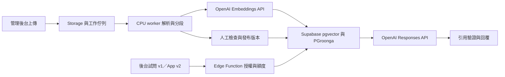

# RAG v1 可行性與資源評估

評估日期：2026-10-24。Status：`candidate_only`。本文件是開工前建議，不代表 RAG 已實作或驗收。

後續文件更新（2026-10-24）：使用者已要求將本次評估整合進[實作規劃](../rag-v1-implementation-plan.md)。以下保留整合前的評估紀錄；「原計畫未改」指評估當時，後續執行方向以更新後規劃為準。

使用者已確認：有 OpenAI Platform API key，希望用來回答使用者問題。因此本報告以 OpenAI API 為模型供應方案，保留 Supabase pgvector；原計畫仍維持原文，沒有直接替換 Gemini 設定。

依據：[原計畫](../rag-v1-implementation-plan.md)、[repo 指南](../AGENTS.md)、[基礎設施查核](rag-v1-infrastructure-research.md)。Git 起點為 `preview/rag-admin-20261024`／`edead04`，當時與本機 remote-tracking branch 一致，未重新驗證遠端部署。原計畫原已是未追蹤檔案。

**判斷：方案可行，pgvector 適合這個規模；先補齊版本、權限與工作重試契約，再進入實作。** 文件預估的 45 份、1,120 頁、1,500–3,000 段屬於小型語料庫；本次沒有取得原始語料重算。主要難度是中文解析、表格數值、引用可信度與發布一致性，硬體不是第一個瓶頸。

## 建議保留的設計

- Supabase 管理 Auth、PostgreSQL、pgvector、中文關鍵字索引、Storage 與 Queues。
- 獨立 Python worker 做文件解析；Edge Function 做授權、檢索、模型呼叫與用量控制。
- 原文、頁碼、清理文字與 embedding profile 分開保存；先精確搜尋，建立召回率基線。
- 係數、費率、油耗交給確定性的計算工具；模型解釋結果並引用來源。
- 發布前評測、人工審核、未發布資料隔離，以及每人和全站的用量上限。

## OpenAI 如何放進現有方案

Codex 可協助開發。產品執行時則由 Edge Function 呼叫 OpenAI Platform API，不需啟動 Codex CLI，也不需在自己的機器載入大型語言模型。API key 與 ChatGPT 訂閱屬於不同的使用／計費方式。[官方認證說明](https://learn.chatgpt.com/docs/auth)

| 工作 | 建議候選 | 採用條件 |
|---|---|---|
| 回答、簡單意圖分類、問題改寫 | `gpt-6-luna`，Responses API；先評測 `none`／`low` reasoning | 低成本候選，並非已證明能通過氣候教練題庫；分類和改寫盡量合併，避免多次往返 |
| 困難題或離線裁判 | 比較 `gpt-6.1-sol` | 先離線比較品質與費用；不要未評測就讓所有問題自動升級 |
| 文件與問題 embedding | `text-embedding-3-small`，1,536 維，cosine | 先做中文、英文來源的檢索基線 |
| embedding 品質對照 | `text-embedding-3-large`，用 `dimensions=1536` | 只有 Recall／排序品質改善才採用；存為另一個 profile |
| OCR／表格 | Docling 主處理；失敗頁再測 OpenAI 視覺輸入 | 必須檢查數字、單位與表格欄位；不是直接換模型名就完成 OCR 遷移 |

模型能力與候選定位依據 [OpenAI 模型目錄](https://developers.openai.com/api/docs/models)、[Luna 模型文件](https://developers.openai.com/api/docs/models/gpt-6-luna)。Luna 支援 function calling 與 structured outputs；本次沒有驗證使用者帳戶的模型權限、限流或品質。

Embedding 是獨立 API 功能。small 預設 1,536 維，large 預設 3,072 維且可指定較短維度。[OpenAI embeddings](https://developers.openai.com/api/docs/guides/embeddings)

遷移時須一併調整：provider／model 設定、模型參數、tokenizer、文件與查詢格式、structured output／tool schema、用量解析、錯誤與重試，以及 OCR 輸入方式。Gemini 的 `thinking_level`、`countTokens`、任務前綴不能假定原樣適用 OpenAI。原 Gemini 前綴確有官方依據，但屬於該模型的輸入契約。[Gemini embeddings](https://ai.google.dev/gemini-api/docs/embeddings)

不同供應商的生成模型與 embedding 可以搭配；同一檢索 profile 內的文件和問題向量必須相容。只換回答模型不需要重算向量；換 embedding 模型或維度要建立新 profile 並重算。現有 RAG 仍是假資料，不能宣稱已有 Gemini 向量需要遷移；可直接在新測試環境建立 OpenAI 基線。[現有掛載入口](../src/push-admin/components/RagWorkspace.tsx)

## 開工前要補的契約

以下前兩項含文件中的明確修正，其餘是根據計畫推導出的設計缺口，不是已發生的程式 bug。

| 優先度 | 計畫位置 | 評估與具體建議 |
|---|---|---|
| 高 | §1、§7，程式位置 | 檔案現在放在網站 repo，「migrations／Functions 放本 repo」會指錯地方。應明寫 `githyoung/carbon-navigation` 放後端、`flutter-nycu/carbonGuide` 放前端，符合 AGENTS.md；worker 的 repo 也要指定。 |
| 中 | §4.2，3,072 維 | `vector` 本身可儲存 3,072 維；2,000 維是一般 vector 的 ANN 索引限制。v1 的 1,536 維可直接用 `vector(1536)`。需 HNSW 時才決定降維、halfvec 或 expression index。[pgvector](https://github.com/pgvector/pgvector#reference) |
| 高 | §4.3，SQL 篩選 | 權限與 release 篩選必須在 SQL 中，但 WHERE 的寫法不保證 HNSW 先篩完整集合。初期精確搜尋；之後以實測選 iterative scan、partial index 等方法，並驗證篩選後召回。[pgvector filtering](https://github.com/pgvector/pgvector#filtering) |
| 高 | §7，知識版本 | `knowledge_releases` 應連到不可修改的文件／chunk／QA／prompt／persona／係數／費率版本或 snapshot。只記一個狀態欄，或連到可覆寫的 QA、係數資料列，都不能保證回滾。 |
| 高 | §5，回答一致性 | 每次請求一開始讀取一個 `release_id`，後續 QA、檢索、父段展開、計算與引用都用同一版本。發布與回滾以 transaction 切換 active release；該 release 必須全部向量可用、評測通過。記錄工具版本與核定係數 ID。 |
| 高 | §8，權限與費用 | 要明列 Storage、RPC、worker 的授權；若伺服器用高權限 key，不能假定 RLS 仍會替它過濾草稿。用量採原子扣額／預留，不可先讀剩餘額度再分開加總；低預算 fallback 本身也須避免繼續付費呼叫模型。 |
| 高 | §3，工作可靠性 | 將 enqueue 與 job 狀態設計為一致；worker 有唯一工作鍵、lease／續租、重試上限、失敗佇列，資料提交完成才 ack。embedding 冪等鍵應覆蓋實際輸入：標題、章節標頭、正文與 profile；只 hash 正文會漏掉標頭修改。[Queues](https://supabase.com/docs/guides/queues/pgmq) |
| 中 | §4.3–4.4，排序與拒答 | RRF 是合併排名，不能套用 cosine 的 0.70 門檻。保留向量分數、關鍵字排名及 RRF 分數，拒答校準與融合排序分開定義。中文 PGroonga 可用，但要測繁體、縮寫、同義詞及中英跨語檢索。[PGroonga](https://supabase.com/docs/guides/database/extensions/pgroonga) |
| 高 | §5–6，引用與評測 | 引用 ID 存在只證明格式正確，還要驗證該頁確實支持主張；QA／計算結果也要有可追溯來源。40–60 題可當起點，保留不參與門檻調整的驗收題；「測試外洩 0 次」不等於安全保證。核心數字題、所有失敗及關鍵權限案例需人工核對。 |
| 中 | §3、§8，輸入與紀錄 | URL 抓取要限制協定、內網目標、redirect、下載大小與時限；PDF／DOCX 設頁數與檔案限制。log 避免保存整份原文和 secrets，使用者雜湊仍可能可識別。刪除與保存期限需涵蓋自己的資料及供應商設定。 |

Cloud Run Jobs 不必下載長效服務帳號金鑰；可用 service identity／ADC，外部觸發可評估 WIF。Edge Function 的 400 秒付費 wall clock 不表示每個 HTTP 請求都能等滿 400 秒，另有 150 秒 idle timeout。部署細節見[基礎設施查核](rag-v1-infrastructure-research.md)。

## 硬體與雲端配置

以下是待量測的工程起點，前提是 Supabase 託管資料庫、OpenAI 託管模型。不是自架 Supabase 或自架 LLM 的規格。

| 用途 | 起始配置 | 建議 |
|---|---|---|
| 開發電腦兼偶爾解析 | 4–8 核 CPU、16 GB RAM、額外 20–50 GB SSD 空間 | 優先用現有電腦；Docker、IDE、瀏覽器及解析同時使用，32 GB RAM 較有餘裕 |
| 雲端解析 worker | 2 vCPU、8 GiB RAM、一次處理 1 件 | 先處理代表文件；複雜檔案比較 4 vCPU／16 GiB，限制頁面緩衝與並行 |
| Supabase 測試 | Free 可試作；需檢查 500 MB DB、1 GB Storage、單檔限制與暫停規則 | 語料原檔大小未知，不能只憑向量大小保證 Free 足夠 |
| 業主驗收／初期服務 | Pro + Micro：共享 CPU、1 GB RAM；有負載壓力再 Small 2 GB | 不以「1,000 個使用者」直接推定規格，量尖峰請求、連線、CPU、RAM、p95 |
| GPU | 暫不採購 | 生成、embedding 走 API；Docling 先 CPU 試跑 |

Supabase 資源與價格依據：[Pricing](https://supabase.com/pricing)、[Compute and Disk](https://supabase.com/docs/guides/platform/compute-and-disk)。worker 規格是估算；Docling 的可調資源與 Cloud Run 限制見[基礎設施查核](rag-v1-infrastructure-research.md)。本機硬體查詢 `Get-CimInstance` 被環境拒絕存取，因此沒有確認這台電腦的 CPU／RAM／空間。

3,000 段、1,536 維向量本體為 `3000 × (4 × 1536 + 8)` = **18,456,000 bytes，約 18.46 MB／17.60 MiB**。不含資料列、原文、索引、歷史版本、log、WAL、備份與文件 Storage。這個數字說明不需要為幾千個向量購買大型主機，不能代替整體容量估算。[儲存公式](https://github.com/pgvector/pgvector#vector-type)

本機 worker 關機只會讓新文件處理等待，不應影響已發布知識的回答。若要業主上傳後自動處理，就需要雲端 worker 和明確的觸發機制；Queues 本身不會啟動 Cloud Run Job。

## 費用試算

查詢日期為 2026-10-24；均為 USD。以下採 Standard、未快取單價，帳戶實際可用模型／費率仍未驗證。

沿用原計畫每題回答輸入 6,000 tokens、輸出 800 tokens，加一次分類／改寫輸入 1,000、輸出 100。輸出假設包含所有計費輸出與 reasoning；如果實際 thinking 更長，費用會增加。多次工具往返也會追加 tokens。

| 回答配置 | 每題推算 | 10,000 題／月 | 90,000 題／月 |
|---|---:|---:|---:|
| Luna 回答 + Luna 分類／改寫 | $0.00115 | $11.50 | $103.50 |
| Sol 回答 + Luna 分類／改寫 | $0.02015 | $201.50 | $1,813.50 |

公式：`(回答輸入 × 回答 input 單價 + 回答輸出 × 回答 output 單價 + 分類輸入 × Luna input 單價 + 分類輸出 × Luna output 單價) / 1,000,000`。Luna input／output 為 $0.10／$0.50，Sol 為 $2／$10。[OpenAI 價格](https://developers.openai.com/api/docs/pricing)

以上不是完整帳單：未含查詢 embedding、OCR、重試、多輪工具、離線評測、Supabase、worker、儲存超額、傳輸與稅；90,000 題只是原計畫的情境，不代表已知需求或通過壓測。

初次 embedding 若實際送入 70 萬–100 萬 tokens，small 約 $0.014–0.020；large 約 $0.091–0.130。這裡只是沿用計畫 token 假設的算式，需把 overlap、標頭、表格展開與不同 tokenizer 的差異算入。[small 單價](https://developers.openai.com/api/docs/models/text-embedding-3-small)、[large 單價](https://developers.openai.com/api/docs/models/text-embedding-3-large)

Supabase 一個 Pro 組織配一個 Micro，約 $25／月；改 Small 約 $30／月。若已有 Pro 專案使用 compute credit，新增一個 Micro 測試 project 通常約增加 $10／月，不能把測試環境成本漏掉。[Supabase 價格](https://supabase.com/pricing)

Cloud Run 2 vCPU／8 GiB 的 Tier 1 未折扣執行價約 $0.1872／小時；假設累計 10 小時是 $1.87，並不是預測這批文件需 10 小時。另計建置、映像儲存、傳輸，免費額度可能抵扣。[計費來源與計算](rag-v1-infrastructure-research.md)

原計畫 Gemini 的主要單價與算式可對上當前官方價格；不是因為 pgvector 不相容而需要換模型。此次 OpenAI 是依使用者已備妥 API 的方向提出候選，是否採用由品質與成本比較決定。[Gemini 價格](https://ai.google.dev/gemini-api/docs/pricing)

## 建議實作順序與驗證門檻

1. 在測試 project 做一條完整流程：5 份代表文件 → 解析 → 人工檢查 → embedding → 發布 → 20 題試問與引用。量解析峰值 RAM、品質、每頁時間；不預設已需要 HNSW 或 rerank。
2. 同一組題目比較 small／large embedding；建立精確向量、中文關鍵字、混合檢索的基線。可先把檢索 p95 300 ms 當討論目標，於 1／5／10 並行測量；這是建議目標，並非已達成數字。
3. 驗證草稿隔離、發布／回滾一致性、worker 重試及並行額度扣除，再串完整後台流程。
4. 擴到完整語料與 40–60 題以上評測，保留獨立驗收題。測 Luna／Sol 回答品質及端到端延遲，再訂正式模型與每月預算。

13–19 個工作天可作熟悉現有系統、文件品質可控時的候選工程估計，不能直接當交付承諾。正式排期須另列資料清理、業主審核、模型比較、部署與權限設定的等待時間。App 對話仍屬 Phase 2；v1 用後台試問驗收，避免 §5「App 呼叫」被誤讀為本次要做 App。

## 任務收尾單

- Task：評估既有 RAG v1 計畫，加入已確認的 OpenAI API 使用方向並規劃硬體／雲端資源。
- Status：`candidate_only`；Mode：`candidate_only`。評估已交付，系統尚未建置驗證。
- Changed files：本報告及 `reports/rag-v1-infrastructure-research.md`；原計畫與程式碼未改。
- Evidence：本報告、基礎設施報告、官方來源、原計畫與 `src/push-admin/components/RagWorkspace.tsx`。
- Verification：執行 `git status --short --branch`、`git log -3 --oneline`；讀取計畫與 repo 規則；優先查 codebase graph，結果不足時讀已知檔案；查閱官方文件，重算向量容量及 API／worker 費用；報告差異與原計畫 SHA-256 檢查。
- Not run：未執行 migration、API 呼叫、真實文件解析、RLS／瀏覽器測試或壓測；本次沒有程式變更，因此未跑 build／type-check／測試套件。未讀正式 DB、未部署、未 commit／push。硬體 CIM 查詢遭環境拒絕。
- Risk：語料總大小、文件解析品質、尖峰併發、實際 API 權限／限額與目標 DB extension 版本未驗證；模型價格會變，配置仍待實測。
- Next：確認候選方向後，在 App repo 建 OpenSpec change 與測試環境，以代表文件完成第一條可量測的真實流程。
